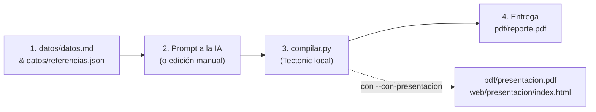

# 🎓 Plantilla Académica · UNAB

<p align="center">
  
  
</p>

<p align="center">
  <strong>Ecosistema local para preparar reportes académicos y presentaciones sincronizadas con identidad institucional y asistencia de IA (Codex / Antigravity).</strong>
</p>

<p align="center">
  
  
  
  
  
  
</p>

---

## 📌 Los Tres Entregables

| Entregable | Formato | Motor / Base | Propósito |
|---|---|---|---|
| 📄 **[Reporte académico](pdf/reporte.pdf)** | PDF (Tamaño Carta) | LaTeX + XeTeX / Tectonic | Documento formal, portada completa, tabla de integrantes, citas APA 7 y firma institucional personal al pie. *(Generado por defecto)* |
| 📊 **[Presentación de diapositivas](pdf/presentacion.pdf)** | PDF (16:9 Panorámico) | LaTeX Beamer (`unab_presentacion`) | Diapositivas para defensa y exposición oral, con pie de expositor por lámina. |
| 🌐 **[Presentación web](web/presentacion/index.html)** | Web interactiva HTML5 | Reveal.js (100% offline) | Exposición interactiva desde el navegador con notas del orador y sincronización de datos con LaTeX. |

> [!NOTE]
> La guía interactiva para estudiantes y acceso rápido a los entregables se encuentra en **[index.html](index.html)**.

---

## 🚀 Flujo de Trabajo en 4 Pasos



### Paso 1: Configurar la rama de trabajo
Si todavía no tienes el repositorio, consulta el [tutorial de clonación por HTTPS o SSH y colaboración en equipo](docs/uso/clonacion-y-ramas.md). Incluye cómo crear y publicar una rama del proyecto sin modificar `main`, y cómo incorporarse a una rama existente.

Trabaja en la rama actual. Si comienzas otro proyecto y necesitas aislarlo, crea una rama descriptiva:
```bash
# Opcional, únicamente para comenzar un trabajo nuevo:
git switch -c materia/nombre-del-proyecto
```

### Paso 2: Completar `datos/datos.md` y `datos/referencias.json`
- Abre **[datos/datos.md](datos/datos.md)** y rellena los datos de la portada (tema, docente, asignatura, grupo, integrantes y firma).
- Registra las fuentes confirmadas en **[datos/referencias.json](datos/referencias.json)** con formato APA 7.

### Paso 3: Pedir asistencia a la IA (Codex / Antigravity)
Copia y envía este prompt al agente de IA:

> *"Lee AGENTS.md y datos/datos.md. Prepara únicamente el reporte para este trabajo, conservando la identidad de la universidad y mi firma. Compila y revisa el PDF."*

*(Si también vas a exponer y necesitas láminas, añade expresamente: "Prepara también la presentación PDF y web").*

### Paso 4: Compilar y revisar entregables
Ejecuta la compilación y abre tus documentos generados en `pdf/`.

---

## ⚙️ Comandos de Compilación

El archivo `compilar.py` es el único punto de entrada para preparar los documentos:

| Comando | Acción | Salidas actualizadas |
|---|---|---|
| `python3 compilar.py` | Compila **exclusivamente el reporte** *(Flujo estándar)* | `pdf/reporte.pdf` |
| `python3 compilar.py --con-presentacion` | Compila reporte **y** presentación (PDF y web) | `pdf/reporte.pdf`, `pdf/presentacion.pdf`, `web/presentacion/index.html` |
| `python3 compilar.py --solo-presentacion` | Compila **solo las diapositivas** para iteración rápida | `pdf/presentacion.pdf`, `web/presentacion/index.html` |
| `python3 compilar.py --verificar` | Valida recursos, citas y coherencia sin compilar | Ninguna (solo diagnóstico) |
| `python3 compilar.py --modo-entrega` | **Modo estricto**: bloquea si quedan textos o fuentes de ejemplo | Según el modo elegido |
| `python3 compilar.py --sin-red` | Compila usando solo el motor y paquetes locales | Según el modo elegido |
| `python3 compilar.py --limpiar` | Elimina la carpeta temporal `.build/` | Purgado de temporales |
| `python3 compilar.py --probar` | Ejecuta la suite de pruebas unitarias (`unittest`) | Diagnóstico de pruebas |

> [!TIP]
> **En VS Code:** Puedes presionar `Ctrl + Shift + B` para compilar directamente el reporte, o ir a **Terminal → Ejecutar tarea** para seleccionar cualquiera de las acciones anteriores en un solo clic.

---

## 📦 Instalación y Reutilización del Compilador

- Requiere **Python 3.9 o superior** (sin necesidad de paquetes `pip`).
- El script **reutiliza automáticamente** Tectonic si ya está instalado en tu sistema (`PATH`).
- Si no está presente, descarga de forma transparente **Tectonic 0.15.0** una sola vez en tu carpeta de usuario local:
  - **Linux:** `~/.local/share/plantilla-unab/tectonic-0.15.0/`
  - **macOS:** `~/Library/Application Support/plantilla-unab/tectonic-0.15.0/`
  - **Windows:** `%LOCALAPPDATA%/plantilla-unab/tectonic-0.15.0/`

Todas tus ramas y clones futuros compartirán el mismo motor sin volver a descargar nada.

---

## 📚 Sistema de Citas y Referencias (APA 7)

Las referencias se centralizan en `datos/referencias.json` y se comparten de manera uniforme entre el reporte y las diapositivas:

### Cómo citar en LaTeX (`documentos/reporte.tex` y `documentos/presentacion.tex`)
- **Cita parentética simple:** `\cita{fuente}` $\rightarrow$ *(Apellido, 2024)*
- **Cita narrativa simple:** `\citatexto{fuente}` $\rightarrow$ *Apellido (2024)*
- **Cita textual con número de página:** `\cita[p. 15]{fuente}` $\rightarrow$ *(Apellido, 2024, p. 15)*
- **Citas múltiples agrupadas:** `\citas{fuente1, fuente2}` $\rightarrow$ *(Apellido1, 2023; Apellido2, 2024)*

### Cómo citar en la Presentación Web (`web/presentacion/index.html`)
- Cita simple: `<span data-cita="fuente"></span>`
- Con localizador: `<span data-cita="fuente" data-localizador="p. 15"></span>`
- Citas múltiples: `<span data-cita="fuente1, fuente2"></span>`

---

## 💻 Características Especiales de Diseño

### 1. Bloques de código con resaltado sintáctico (`listings`)
La plantilla incluye el estilo `unabcode` que armoniza con los colores institucionales:
```latex
\begin{lstlisting}[language=Python, caption={Algoritmo de cálculo}]
def calcular_promedio(notas):
    return sum(notas) / len(notas) if notas else 0
\end{lstlisting}
```
*(En Beamer, recuerda declarar `\begin{frame}[fragile]{Título}`).*

### 2. Cajas de notas destacadas
Para enfatizar advertencias, recomendaciones o consideraciones metodológicas en el reporte:
```latex
\begin{cajanota}[Consideración Metodológica]
  Los datos analizados fueron recolectados durante el período lectivo 2026.
\end{cajanota}
```

### 3. Firma personal institucional
Al final del reporte (incluso tras los anexos) se imprime automáticamente la firma tipográfica con la fuente original de [assets/fuentes/firma.otf](assets/fuentes/firma.otf). El nombre se toma del campo `Firma` en `datos/datos.md`.

---

## 📂 Estructura del Repositorio

```text
├── README.md / AGENTS.md         # Guía y reglas de trabajo
├── compilar.py                   # Único punto de entrada de compilación
├── index.html                    # Portal de acceso y guía interactiva
├── datos/                        # datos.md y referencias.json
├── documentos/                   # reporte.tex y presentacion.tex
│   ├── secciones/                # Fragmentos de reportes extensos
│   └── anexos/                   # Fuentes de anexos
├── plantilla/latex/              # Estilos institucionales .sty
├── web/
│   ├── portal/{css,js}/          # Recursos del portal principal
│   └── presentacion/             # index.html, css/ y js/ de las diapositivas
├── assets/
│   ├── institucional/            # Logos originales y acreditación
│   ├── fuentes/                  # Firma tipográfica original
│   ├── iconos/fontawesome/       # SVG oficiales, versión y licencia
│   └── contenido/                # imagenes/, graficos/ y evidencias/
├── herramientas/                 # Compilación, contenido, iconos y validación
├── vendor/                       # Reveal.js, Bootstrap y Font Awesome locales
├── ejemplos/reveal-demo.html     # Demo de referencia, con recursos remotos
├── docs/                         # Índice y mapa de estructura
│   ├── uso/                      # Clonación, guía de uso y personalización
│   └── mantenimiento/            # Registro de verificación
├── pdf/                          # reporte.pdf y presentacion.pdf
├── tests/                        # Pruebas automatizadas
├── .vscode/tasks.json            # Acciones de VS Code
└── .build/                       # Temporales generados; ignorados por Git
```

---

## 🧪 Pruebas Automatizadas

Los nuevos commits siguen [Conventional Commits 1.0.0](docs/mantenimiento/commits.md),
por ejemplo: `docs(portal): simplifica el tutorial de Git`.

GitHub Actions ejecuta las pruebas, revisa enlaces locales y verifica coherencia
en cada push y Pull Request, sin compilar PDF. Consulta la
[validación automática](docs/mantenimiento/validacion-automatica.md).

Para verificar la integridad del compilador, el parser de citas y la coherencia de datos:

```bash
python compilar.py --probar
```
O bien:
```bash
python -m unittest discover tests
```

---

<p align="center">
  <sub>Desarrollado con identidad institucional para la Universidad Dr. Andrés Bello · 2026</sub>
</p>

## Iconos y organización

Consulta el [índice de documentación](docs/README.md) para distinguir las guías
de uso de los documentos de mantenimiento de la plantilla.
Antes de entregar un trabajo, completa la [lista de revisión](docs/uso/lista-de-entrega.md).

Se pueden descargar iconos adicionales de **Font Awesome Free** cuando el contenido los necesite.
Guárdalos en `assets/iconos/fontawesome/solid/`, conserva su licencia y usa la herramienta local:

```bash
python3 -m herramientas.iconos --descargar microscope shield-halved --sincronizar
```

La descarga requiere red; las diapositivas resultantes funcionan sin conexión. La herramienta
actualiza la biblioteca SVG incorporada en el HTML; no añade iconos automáticamente al contenido.
Consulta [personalización](docs/uso/personalizacion.md), [estructura](docs/estructura.md) y
[guía de uso](docs/uso/guia-de-uso.md). Para comprobar rutas después de mover recursos:

```bash
python3 -m herramientas.validacion
```

La etiqueta colectiva es **Grupo**, tomada de `datos/datos.md`; para una persona concreta,
usa su nombre como expositor. No mantengas copias de los mismos datos en otras carpetas.


El portal principal también funciona sin conexión: Bootstrap 5.3.3 y Font Awesome Free
6.7.2 están en `vendor/` con sus licencias. Incluye comandos copiables para Windows y
Linux/macOS, tema del sistema y navegación móvil. Las vistas previas son capturas reales
de los PDF de ejemplo; su actualización se explica en
[assets/contenido/vistas-previas/README.md](assets/contenido/vistas-previas/README.md).

## Licencia

El código y la documentación originales se ofrecen bajo [MIT](LICENSE).
Los logos institucionales, la fuente personal de firma y los materiales de terceros
conservan sus propias condiciones: consulta el [alcance y las exclusiones](docs/mantenimiento/licencias.md).
